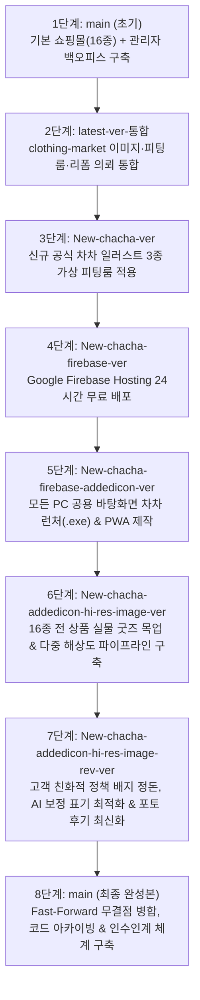
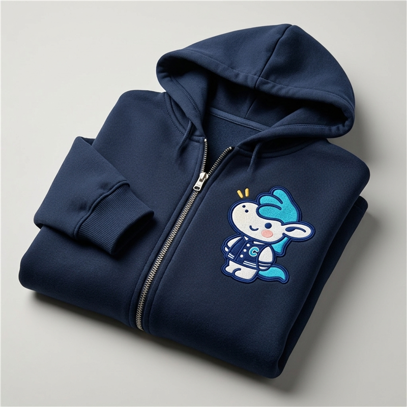
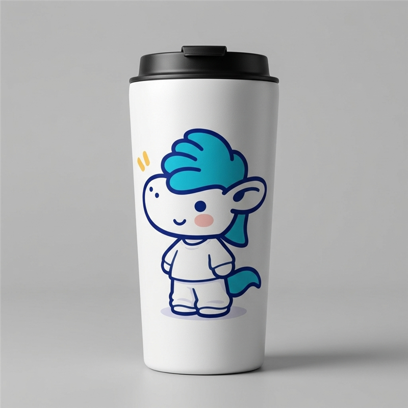
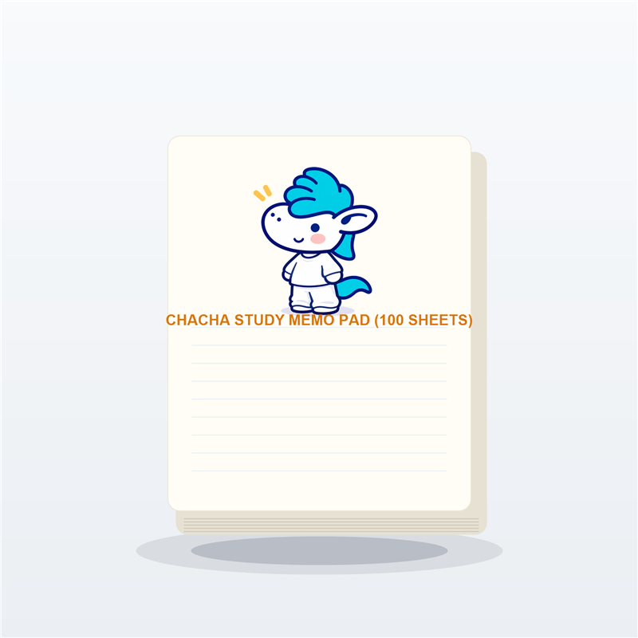
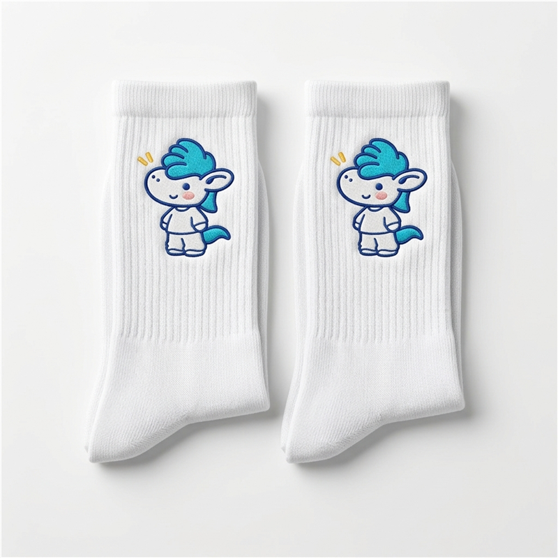
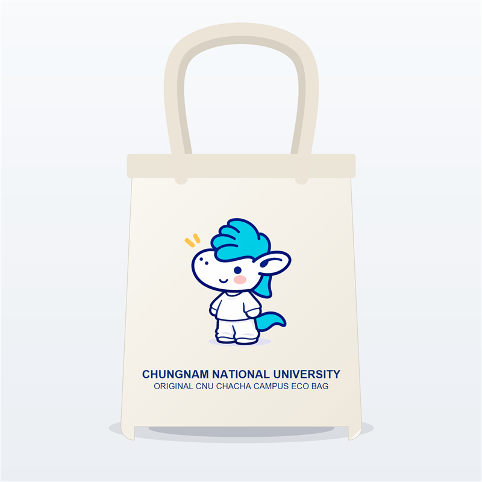
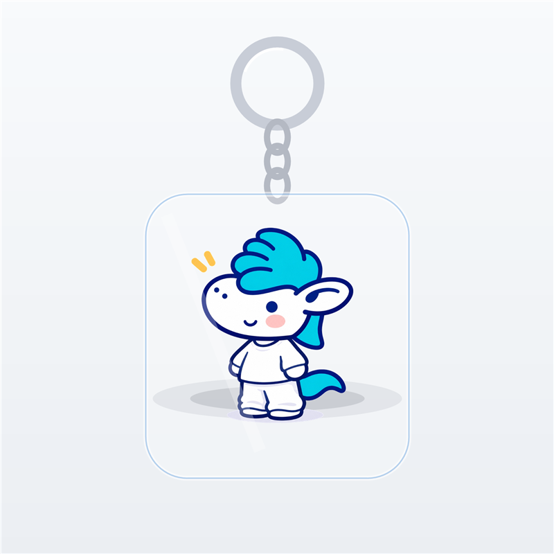

# 🦄 CNU 차차 스토어(CHA CHA STORE) 전체 개발 및 배포 가이드 (초보자용 종합 해설서)

이 문서는 **충남대학교 공식 마스코트 '차차(CHA CHA)' 굿즈 쇼핑몰**을 처음 기획하고 구축하는 단계부터, 기존 프로젝트 기능 통합, 고해상도 신규 일러스트 가상 피팅룸 업그레이드, 24시간 무중단 Firebase 클라우드 배포, 모든 PC 공용 바탕화면 바로가기 런처 제작, 16종 전 상품 실물 굿즈 스튜디오 목업 파이프라인 구축, 고객 친화적 전자상거래 정책 배지 리팩토링, 그리고 최종 `main` 브랜치 병합 및 개발자 인수인계 체계 수립까지의 **전체 작업 과정과 핵심 기술 개념을 초보자도 쉽게 이해할 수 있도록 정리한 종합 가이드북**입니다.

---

## 🦄 차차 이미지를 클릭하면 실제 24시간 운영 사이트로 바로 이동합니다!

| [](https://cnu-chacha-store.web.app) | [](https://cnu-chacha-store.web.app/fitting) | [](https://cnu-chacha-store.web.app/admin/dashboard) |
| :---: | :---: | :---: |
| **[👉 메인 스토어 바로가기](https://cnu-chacha-store.web.app)**<br/>충남대 차차 공식 굿즈 쇼핑몰 | **[👉 VR 가상 피팅룸 바로가기](https://cnu-chacha-store.web.app/fitting)**<br/>NEW 차차 옷 입히기 체험관 | **[👉 관리자 백오피스 바로가기](https://cnu-chacha-store.web.app/admin/dashboard)**<br/>통합 운영 & 제작 의뢰 관리 |

### 💻 Windows 바탕화면 차차 아이콘 바로가기 다운로드 (모든 PC 공용)
1. **[🦄 차차 아이콘 내장 단일 런처 다운로드 (`CNU-ChaCha-Store.exe`)](https://github.com/business5cnu-cloud/cnu-chacha-store/raw/New-chacha-firebase-addedicon-ver/public/downloads/CNU-ChaCha-Store.exe)**: 파일 자체에 차차 아이콘이 내장된 초경량(57KB) 실행형 바로가기로, 어느 PC 바탕화면에 두어도 차차 아이콘이 유지되며 더블클릭 시 즉시 스토어가 열립니다.
2. **[⚡ 바탕화면 바로가기 자동 생성기 다운로드 (`install-chacha-shortcut.bat`)](https://github.com/business5cnu-cloud/cnu-chacha-store/raw/New-chacha-firebase-addedicon-ver/public/downloads/install-chacha-shortcut.bat)**: 실행 시 Firebase 서버에서 차차 공식 아이콘을 자동 다운로드하고 바탕화면에 `CNU 차차 스토어.url` 바로가기를 생성합니다.

---

## 📌 한눈에 보는 프로젝트 진화 과정 (Git 브랜치 흐름도)

우리가 작업한 프로젝트는 단계별로 **총 8개의 Git 브랜치와 마일스톤**으로 발전해왔습니다. 각 단계는 마치 게임의 '세이브 포인트'처럼 보존되어 있어 언제든 당시의 코드를 확인하거나 비교해 볼 수 있습니다.



| 순서 | 브랜치 / 단계 | 주요 핵심 작업 요약 | GitHub 코드 링크 |
| :---: | :--- | :--- | :--- |
| **1단계** | `main` (초기) | 충남대 차차 스토어 기본 쇼핑몰(16종 상품) + 관리자 백오피스 완성 | [코드 보기](https://github.com/business5cnu-cloud/cnu-chacha-store/tree/main) |
| **2단계** | `latest-ver-통합` | `clothing-market` 폴더의 실물 이미지 19종, 학우 후기, 찜하기, 가상 피팅룸, 과잠 리폼 의뢰 통합 | [코드 보기](https://github.com/business5cnu-cloud/cnu-chacha-store/tree/latest-ver-%ED%86%B5%ED%95%A9) |
| **3단계** | `New-chacha-ver` | 직접 제공해주신 고해상도 공식 NEW 차차 일러스트 3종(기본·과잠·학사복)으로 가상 피팅룸 업그레이드 | [코드 보기](https://github.com/business5cnu-cloud/cnu-chacha-store/tree/New-chacha-ver) |
| **4단계** | `New-chacha-firebase-ver` | 내 컴퓨터를 꺼도 전 세계 누구나 24시간 접속할 수 있도록 Google Firebase Hosting에 배포 | [코드 보기](https://github.com/business5cnu-cloud/cnu-chacha-store/tree/New-chacha-firebase-ver) |
| **5단계** | `New-chacha-firebase-addedicon-ver` | 다른 사람 PC 바탕화면에서도 차차 아이콘이 영구히 보존되는 전용 단일 런처(`.exe`) 및 PWA 추가 | [코드 보기](https://github.com/business5cnu-cloud/cnu-chacha-store/tree/New-chacha-firebase-addedicon-ver) |
| **6단계** | `New-chacha-addedicon-hi-res-image-ver` | 16종 전 상품 평면 일러스트를 실물 스튜디오 목업으로 전면 교체 및 다중 해상도 반응형 이미지 시스템 도입 | [코드 보기](https://github.com/business5cnu-cloud/cnu-chacha-store/tree/New-chacha-addedicon-hi-res-image-ver) |
| **7단계** | `New-chacha-addedicon-hi-res-image-rev-ver` | 내부 정책 배지 제거, 전자상거래법 준수 [정책 7] AI 그래픽 보정 안내 조건부 표기, 포토 후기 실물화 | [코드 보기](https://github.com/business5cnu-cloud/cnu-chacha-store/tree/New-chacha-addedicon-hi-res-image-rev-ver) |
| **8단계** | `main` (최종) | `main` 브랜치 무결점 병합, 일회성 스크립트 격리 보관, 개발자 인수인계서 및 AI 품질 규칙 공식 수립 | [코드 보기](https://github.com/business5cnu-cloud/cnu-chacha-store/tree/main) |

---

## 🛠️ 단계별 상세 작업 내용 & 초보자 맞춤 해설

---

### 1단계: 기본 쇼핑몰 & 관리자 백오피스 구축 (`main` 브랜치)

#### 📌 무엇을 만들었나요?
1. **고객용 쇼핑몰 (`/`, `/products`, `/cart`, `/checkout`, `/mypage`)**
   - **4대 카테고리**(의류, 문구, 잡화, 한정판)와 **16종의 공식 차차 굿즈**(후드티, 양말, 메모지, 스티커, 그립톡, 키링, 텀블러, 피규어, 노트북 파우치, 보조배터리, 양치세트, 여행 파우치, 방향제, 에코백, 커스텀 인형, 한정판 인형)를 구성했습니다.
   - 장바구니 담기, 옵션 선택에 따른 추가 금액 실시간 계산, 3만 원 이상 무료배송 자동 적용, 토스페이먼츠 연동 테스트 결제 환경을 구축했습니다.
2. **관리자 전용 백오피스 (`/admin/dashboard`, `/admin/products`, `/admin/orders`, `/admin/sales`, `/admin/inventory`, `/admin/customers`, `/admin/limited`)**
   - 쇼핑몰 운영자가 일별/월별 매출 그래프를 확인하고, 신규 상품 등록 및 수정, 재고 입고/출고, 주문 상태 변경, 판매 데이터 CSV 엑셀 다운로드를 수행할 수 있는 전문 운영 시스템을 만들었습니다.

> 💡 **초보자를 위한 핵심 개념 설명**
> - **프론트엔드(Frontend)와 백오피스(Backoffice)**: 손님이 예쁘게 진열된 굿즈를 구경하고 쇼핑하는 매장 진열대가 '프론트엔드'라면, 사장님이 재고를 확인하고 매출 장부를 정리하는 사무실이 '백오피스(`/admin`)'입니다.
> - **반응형 웹(Responsive Web)**: 화면 크기가 작은 스마트폰부터 커다란 PC 모니터까지 어떤 기기로 접속하더라도 레이아웃이 어색하지 않게 자동으로 딱 맞추어 재배치되는 현대적인 웹 디자인 기술입니다 (Tailwind CSS 활용).

---

### 2단계: `clothing-market` 핵심 기능 및 실물 이미지 19종 통합 (`latest-ver-통합` 브랜치)

#### 📌 무엇을 만들었나요?
기존에 따로 작업되어 있던 `clothing-market` 프로젝트의 기능과 실제 차차 그래픽 리소스 19종을 우리 쇼핑몰에 하나로 병합했습니다.

1. **실제 차차 이미지 19종 탑재 (`public/images/chacha/`, `public/images/products/`)**
   - 메인 캐릭터 배너, 로고, 마스코트 일러스트, 굿즈 실물 사진, 학우 포토 후기 사진을 사이트 곳곳에 배치했습니다.
2. **VR 가상 피팅룸 베이스 구축 (`/fitting`)**
   - 차차 인형에게 의상과 소품을 입혀보고, 선택한 코디 조합의 금액을 확인해 장바구니로 바로 담는 인터랙티브 체험 공간을 제작했습니다.
3. **찜하기(`♥`), 별점 후기, 슬라이드 장바구니 서랍 (`CartDrawer.tsx`)**
   - 상품 카드에서 하트를 눌러 찜할 수 있고, 장바구니 버튼 클릭 시 화면 오른쪽에서 서랍처럼 부드럽게 열리는 사이드 패널을 추가했습니다.
4. **학과 단체 주문제작 & 헌 과잠 업사이클링 리폼 의뢰 시스템**
   - 졸업생 헌 과잠을 활용한 인형 옷 리폼이나 단체 굿즈 제작 신청 모달(`CommissionModal.tsx`)을 개발하고, 관리자 페이지(`/admin/commissions`)에서 접수 현황과 상담 메모를 실시간 관리할 수 있게 연결했습니다.

> 💡 **초보자를 위한 핵심 개념 설명**
> - **전역 상태 관리 (Global State Management)**: 손님이 상세 페이지에서 누른 '하트(찜)'나 '장바구니 담기' 내용이 메인 홈 화면이나 관리자 화면에서도 똑같이 유지되도록, 웹사이트 전체가 공유하는 공용 기억 저장소(`useStore.tsx` + `localStorage`)를 구축한 것입니다.

---

### 3단계: 신규 공식 차차 일러스트 3종 가상 피팅룸 업그레이드 (`New-chacha-ver` 브랜치)

#### 📌 무엇을 만들었나요?
직접 제공해주신 고해상도(1024×1024) 충남대 공식 신규 차차 일러스트 3장을 가상 피팅룸(`/fitting`)의 주인공으로 교체했습니다.

- **기본 화이트 셋업 차차**: [`fitting_basic.jpg`](./public/images/chacha/fitting_basic.jpg)
- **충남대 과잠 착용 차차**: [`fitting_varsity.jpg`](./public/images/chacha/fitting_varsity.jpg)
- **골드 태슬 학사모 & 학사복 차차**: [`fitting_graduation.jpg`](./public/images/chacha/fitting_graduation.jpg)
- **원클릭 공식 룩북 프리셋**: 버튼 하나로 3가지 공식 룩북을 즉시 전환할 수 있게 구현했으며, 볼캡, 화관, 후드티 등 추가 소품 SVG 레이어도 새로운 차차의 외곽선 두께와 체형 비율에 완벽히 들어맞도록 정밀 재설계했습니다.

> 💡 **초보자를 위한 핵심 개념 설명**
> - **SVG 투명 레이어 합성 (Transparent Vector Overlay)**: 종이 인형 위에 투명한 셀로판지(OHP 필름) 옷을 얹는 원리와 같습니다. 고화질 차차 사진 위에 배경이 투명한 벡터 그래픽(`<svg viewBox="0 0 1024 1024">`)을 좌표 1픽셀 단위로 정확히 겹쳐 올려서 캐릭터의 털 질감은 그대로 유지하면서 옷과 모자만 자연스럽게 갈아입힐 수 있습니다.

---

### 4단계: 내 컴퓨터를 꺼도 24시간 돌아가는 Firebase 무료 배포 (`New-chacha-firebase-ver` 브랜치)

#### 📌 무엇을 만들었나요?
내 컴퓨터에서 개발 서버를 켰을 때만 볼 수 있던 사이트를 **Google Firebase Hosting(`https://cnu-chacha-store.web.app`)** 에 배포하여, 내 컴퓨터를 끄거나 외출해도 전 세계 어디서든 365일 24시간 무료로 접속할 수 있게 만들었습니다.

1. **Next.js 정적 사이트 사전 생성 (`output: 'export'`)**
   - 16종 상품 상세페이지, 4개 카테고리, 통계 화면 등 총 60개의 페이지를 미리 완성된 HTML 웹 문서로 빌드(`out/` 폴더)하여 로딩 속도를 극대화했습니다.
2. **Google 글로벌 CDN 배포**
   - 신용카드 결제가 필요 없는 **100% 무료 요금제(Spark 플랜)** 범위 안에서 안정적으로 호스팅되도록 최적화했습니다.

> 💡 **초보자를 위한 핵심 개념 설명**
> - **`localhost:3000` vs 클라우드 웹 호스팅**: `localhost`는 '내 방 책상 서랍 속에만 들어있는 일기장' 같아서 내 컴퓨터를 끄면 다른 사람은 볼 수 없습니다. 반면 **Firebase 클라우드 호스팅**은 전 세계에 지점을 둔 '구글 대형 도서관'에 우리 사이트를 맡겨두는 것과 같아서, 컴퓨터를 꺼도 언제 어디서나 스마트폰으로 접속할 수 있습니다.

---

### 5단계: 모든 PC 공용 바탕화면 차차 런처 & PWA 제작 (`New-chacha-firebase-addedicon-ver` 브랜치)

#### 📌 무엇을 만들었나요?
내 컴퓨터에서만 작동하는 임시 바로가기가 아니라, **친구에게 파일을 보내주거나 사이트에서 내려받아도 차차 아이콘이 영구히 깨지지 않는 전용 런처**를 구현했습니다.

1. **전용 아이콘 변환 ([`chacha_icon.ico`](./public/images/chacha/chacha_icon.ico))**: 차차 과잠 일러스트를 Windows 공식 규격(256×256) 아이콘 파일로 정밀 변환했습니다.
2. **차차 아이콘이 내장된 57KB 초경량 단일 런처 ([`CNU-ChaCha-Store.exe`](https://github.com/business5cnu-cloud/cnu-chacha-store/raw/New-chacha-firebase-addedicon-ver/public/downloads/CNU-ChaCha-Store.exe))**:
   - 일반 바로가기(`.url`)는 아이콘 이미지를 로컬 하드디스크 경로에서 찾기 때문에 다른 컴퓨터로 옮기면 하얀 종이 모양으로 깨집니다.
   - 이를 해결하기 위해 Windows 내장 C# 컴파일러(`csc.exe`)로 **차차 아이콘 바이너리를 실행 파일 내부에 영구 각인**했습니다. 이 파일은 어느 PC 바탕화면으로 복사해도 차차 아이콘이 100% 선명하게 유지되며, 더블클릭 시 즉시 스토어로 연결됩니다.
3. **자동 생성기 스크립트 ([`install-chacha-shortcut.bat`](https://github.com/business5cnu-cloud/cnu-chacha-store/raw/New-chacha-firebase-addedicon-ver/public/downloads/install-chacha-shortcut.bat)) & PWA 웹앱**:
   - 웹사이트 상단 헤더에 **[🦄 바탕화면 바로가기 받기]** 버튼을 추가하고, Chrome/Edge 브라우저의 **[앱 설치]** 기능도 완벽 지원하도록 `manifest.json`을 구성했습니다.

> 💡 **초보자를 위한 핵심 개념 설명**
> - **참조형 바로가기 vs 바이너리 리소스 내장 런처**: 참조형 바로가기는 '종이쪽지에 적힌 집 주소'와 같아서 그 집에 가봤을 때 사진 파일이 없으면 길을 잃어버립니다. 반면 리소스 내장 런처는 '사진을 코팅해서 파일 몸체 속에 직접 압축해 넣은 것'이므로 파일 하나만 떼어내어 다른 사람의 컴퓨터로 보내도 아이콘이 절대로 사라지지 않습니다.

---

### 6단계: 16종 전 상품 실물 굿즈 목업 및 다중 해상도 파이프라인 구축 (`New-chacha-addedicon-hi-res-image-ver` 브랜치)

#### 📌 무엇을 만들었나요?
평면 2D 일러스트 캐릭터 그림으로만 채워져 있던 16개 전체 상품 이미지를, **전문 스튜디오 조명과 패브릭·세라믹 질감이 살아있는 '실물 굿즈 3D 목업' 및 '스튜디오 실물 사진'으로 전면 교체**했습니다.

```
📷 16종 실물 굿즈 다중 해상도 파이프라인 구조
public/images/products/
├── thumbnail/   (100×100  - 장바구니/주문서 초고속 로딩용)
├── medium/      (400×400  - 메인 그리드 및 카테고리 카드용)
├── large/       (800×800  - 상품 상세 돋보기 확대용)
└── lifestyle/   (실제 착용 및 캠퍼스 일상 연출 샷)
```

1. **8대 품질 보증 기준 적용**: 스튜디오 3점 조명, 자연스러운 그림자, 원단 자수 텍스처, 1:1 정방형 규격 통일.
2. **다중 해상도 반응형 이미지 시스템**:
   - 장바구니 목록에는 초경량 `thumbnail`을, 메인 갤러리에는 선명한 `medium`을, 상세 페이지에는 초고화질 `large`를 자동으로 불러와 데이터 낭비를 막고 화면 로딩 속도를 비약적으로 개선했습니다.
3. **로컬스토리지 캐시 키 버전 동기화 (`v20261105-realgoods-v4`)**:
   - 기존 방문자의 브라우저에 남아있던 옛 일러스트 캐시를 강제 초기화하여 모든 사용자가 최신 실물 굿즈를 즉시 볼 수 있게 조치했습니다.

> 💡 **초보자를 위한 핵심 개념 설명**
> - **다중 해상도 파이프라인 (Multi-Resolution Pipeline)**: 손바닥만 한 스마트폰 화면이나 조그만 장바구니 썸네일에 10MB짜리 거대한 원본 사진을 매번 불러오면 손님의 모바일 데이터 요금이 낭비되고 화면이 버벅거립니다. 따라서 주방에서 식재료를 용도에 맞게 다듬어 두듯, 큰 화면용·중간 화면용·작은 화면용 사진을 미리 규격별로 준비해 두고 브라우저가 상황에 맞게 쏙쏙 골라 쓰게 하는 기술입니다.
> - **캐시 버스팅 (Cache Busting)**: 브라우저가 "어? 나 이 사이트 예전에 와봤는데?" 하면서 옛날 저장된 이미지를 계속 보여주려고 할 때, "새로운 버전 번호(`realgoods-v4`)가 나왔으니 이전 것은 버리고 새 이미지를 받아와!"라고 똑똑하게 강제 갱신시키는 기법입니다.

#### 🛍️ 완성된 16종 공식 실물 굿즈 목업 갤러리 미리보기

| 의류 (후드티 / 양말) | 잡화 (텀블러 / 에코백) | 문구 (메모지 / 그립톡) | 한정판 (피규어 / 키링) |
| :---: | :---: | :---: | :---: |
| <br/>**차차 시그니처 자수 후드티** | <br/>**세라믹 코팅 보온 텀블러** | <br/>**차차 다이어리 점착 메모지** | <br/>**한정판 차차 과잠 피규어** |
| <br/>**코튼 스포츠 차차 양말** | <br/>**헤비 캔버스 차차 에코백** | <br/>**에폭시 마그네틱 그립톡** | <br/>**아크릴 글리터 키링** |

---

### 7단계: 고객 친화적 정책 배지 정돈, 전자상거래 AI 보정 표기 & 포토 후기 최신화 (`New-chacha-addedicon-hi-res-image-rev-ver` 브랜치)

#### 📌 무엇을 만들었나요?
1. **고객 화면에서 불필요한 내부 개발용 배지 제거**
   - 상품 상세 페이지 상단에 노출되던 `[정책 1: 실물 목업 우선]`, `[정책 2: 1:1 렌더링]` 같은 내부 지침 배지를 과감히 삭제하여 고객이 오직 상품 정보와 쇼핑에만 집중할 수 있도록 UI를 깔끔하게 정돈했습니다.
2. **전자상거래 소비자 보호 기준에 맞춘 `[정책 7] AI 그래픽 보정 안내` 개편**
   - 공정거래위원회 지침 및 전자상거래 표준에 따라, 실제 제조 사진이 아닌 AI 렌더링이나 그래픽 합성이 가미된 상품에만 조건부로 배지가 뜨도록 로직을 정교화했습니다.
   - 튀는 경고창 느낌 대신 부드러운 인디고 톤(`bg-indigo-50/80 text-indigo-700`)의 세련된 안내 칩 형태로 디자인을 업그레이드했습니다.
3. **메인 홈 학우 포토 후기 4종 실물 목업 교체**
   - 메인 화면 하단 "학우들의 리얼 포토 후기" 카드에 남아있던 옛날 캐릭터 그림을, 실제 학생들이 스튜디오나 일상에서 착용한 실물 목업 사진(후드티, 양말, 텀블러, 키링)으로 전면 교체하여 신뢰도와 현장감을 끌어올렸습니다.

> 💡 **초보자를 위한 핵심 개념 설명**
> - **UX(사용자 경험) 중심의 정보 분리**: "우리는 내부적으로 1:1 정방형 렌더링 정책을 씁니다" 같은 기술적인 이야기는 손님이 알 필요가 없는 내부 규칙입니다. 손님에게는 구매 결정에 꼭 필요한 "이 상품은 AI 그래픽 시뮬레이션이 반영된 이미지입니다"라는 소비자 보호 안내만 정직하고 투명하게 알려주는 것이 훌륭한 쇼핑몰 UX 디자인의 핵심입니다.

---

### 8단계: `main` 브랜치 정식 병합, 코드 청결화 & 개발자 인수인계 체계 구축 (`main` 브랜치)

#### 📌 무엇을 만들었나요?
수많은 혁신 기능 개발을 모두 마치고, 상용 배포 브랜치인 **`main` 브랜치로 충돌(Conflict) 0건의 완벽한 Fast-Forward 병합**을 완료했습니다.

1. **개발 작업 공간 청결 유지 (Clean Workspace Architecture)**
   - 작업 과정에서 임시로 작성되었던 이미지 생성/검증용 일회성 스크립트들을 모두 `scripts/archive/` 폴더로 격리 보관하고, 서비스 운영에 꼭 필요한 `scripts/serve_out.js`만 루트에 남겨두었습니다.
2. **개발자 인수인계서 및 코딩 표준 공식 수립 ([`docs/HANDOVER_AND_CODING_STANDARDS.md`](./docs/HANDOVER_AND_CODING_STANDARDS.md))**
   - 다음 사람이 이 코드를 이어받아도 첫날부터 프로젝트 구조, 환경 변수, 데이터 흐름, 컴포넌트 설계 철학을 한 번에 이해할 수 있도록 상세 인수인계 가이드를 작성했습니다.
3. **AI 및 개발자가 지켜야 할 '커밋 전 3단계 무결성 검증 규칙' 강제화**
   - 코드 수정 후에는 누구나 반드시 아래 3단계를 통과해야만 커밋할 수 있도록 규칙 파일(`.agents/rules/`, `AGENTS.md`, `GEMINI.md`)을 확립했습니다:
     1. `npm run typecheck` (`tsc --noEmit`): 타입 에러 0건 통과
     2. `npm run test` (`vitest run`): 단위 테스트 전체 통과
     3. `npm run build` (`next build`): 60개 정적 웹 페이지 빌드 성공
4. **Firebase Hosting 최신 프로덕션 배포 완료**
   - 무료 요금제(Spark) 보안 규정에 따라 `.exe`, `.bat` 바이너리 파일이 빌드 산출물에 섞여 배포가 차단되는 문제를 원천 차단하고, 최신 쇼핑몰을 `https://cnu-chacha-store.web.app`에 무결점으로 배포했습니다.

> 💡 **초보자를 위한 핵심 개념 설명**
> - **Fast-Forward 병합 (빨리감기 병합)**: 두 사람이 서로 다른 길로 가서 생긴 복잡한 갈림길을 억지로 이어붙이는 게 아니라, 출발지점(`main`)에서 시작해 한 방향으로만 차근차근 전진했기 때문에 아무런 교통사고(코드 충돌) 없이 깃발의 위치만 맨 앞 최신 지점으로 쑥 옮겨놓는 가장 완벽하고 깔끔한 Git 병합 방식입니다.
> - **CI(지속적 통합) 3단계 무결성 검증**: 사람이 작성한 코드는 사소한 오타 하나로도 전체 사이트가 멈출 수 있습니다. 이를 방지하기 위해 저장소에 올리기 전 컴퓨터가 자동으로 "타입 오류는 없는가?", "기존 기능 테스트를 통과하는가?", "60개 페이지가 완벽히 구워지는가?"를 3중으로 검사해 시스템이 절대 망가지지 않게 지켜주는 안전벨트입니다.

---

## 📂 저장소 디렉터리 구조 및 파일 맵

```
cnu-chacha-store/
├── docs/
│   └── HANDOVER_AND_CODING_STANDARDS.md  # 📘 개발자 인수인계서 및 코딩 표준 가이드
├── public/
│   ├── downloads/                        # 💻 바탕화면 바로가기 런처 배포 파일 (.exe, .bat)
│   └── images/
│       ├── chacha/                       # 🦄 차차 공식 일러스트 (기본, 과잠, 학사복, 아이콘)
│       └── products/                     # 🛍️ 16종 실물 굿즈 다중 해상도 이미지 (thumbnail, medium, large)
├── scripts/
│   ├── serve_out.js                      # 🚀 로컬 정적 빌드 테스트용 경량 서버
│   ├── README.md                         # 📜 스크립트 관리 및 아카이브 가이드
│   └── archive/                          # 📦 이전 작업 일회성 스크립트 보관소
├── src/
│   ├── app/                              # 🌐 Next.js App Router (쇼핑몰, 피팅룸, 백오피스)
│   ├── components/                       # 🧩 UI 재사용 컴포넌트 (공통, 스토어, 어드민)
│   ├── hooks/                            # 🪝 전역 상태 관리 훅 (useStore.tsx)
│   └── lib/                              # 📚 비즈니스 로직, 16종 상품 데이터 정의, 결제 유틸
├── .agents/rules/                        # 🤖 Antigravity/AI 개발 규칙 정의
├── AGENTS.md / GEMINI.md                 # 📋 커밋 전 무결성 검사 및 클린 코드 수칙
├── firebase.json / .firebaserc           # 🔥 Firebase Hosting 배포 설정
├── cnu-chacha-store.md                   # 🏗️ 스토어 초기 구축 명세서
└── README.md / WORK_HISTORY_GUIDE.md     # 📖 전체 작업 히스토리 및 초보자용 가이드
```

---

## 🚀 사이트 실행 및 배포 명령어 안내 (북마크용)

### 1. 내 컴퓨터에서 사이트 켜기 (개발 모드)
```bash
# 1. 필요한 프로그램 패키지 설치
npm install

# 2. 로컬 개발 서버 시작 (웹 브라우저에서 http://localhost:3000 접속)
npm run dev
```

### 2. 코드를 수정한 뒤 무결성 3단계 검사하기
```bash
# 1단계: 타입 에러 검사 (에러 0건 확인)
npm run typecheck

# 2단계: 단위 테스트 검사 (전체 통과 확인)
npm run test

# 3단계: 정적 빌드 검사 (60개 페이지 생성 확인)
npm run build
```

### 3. Google Firebase Hosting에 실제 배포하기
```bash
# 빌드 산출물(out/ 폴더)을 24시간 실서버로 업로드
npx firebase-tools deploy --only hosting --non-interactive
```

---

## 🔗 주요 링크 & 테스트 계정 정보

- **메인 쇼핑몰**: https://cnu-chacha-store.web.app
- **NEW 차차 VR 가상 피팅룸**: https://cnu-chacha-store.web.app/fitting
- **관리자 백오피스 (대시보드)**: https://cnu-chacha-store.web.app/admin/dashboard
- **관리자 주문제작·과잠 리폼 관리**: https://cnu-chacha-store.web.app/admin/commissions
- **총괄 관리자 로그인**: `admin@cnu.ac.kr` / 비밀번호: `admin1234!`
- **일반 학우(고객) 로그인**: `chacha.fan@o.cnu.ac.kr` / 비밀번호: `cnu1234!`
