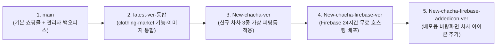

# 🦄 CNU 차차 스토어(CHA CHA STORE) 전체 개발 및 배포 가이드 (초보자용 해설서)

이 문서는 **충남대학교 공식 마스코트 '차차(CHA CHA)' 굿즈 쇼핑몰**을 처음 구축하는 단계부터, 기존 사이트 기능 통합, 신규 일러스트 가상 피팅룸 업그레이드, 24시간 무중단 Firebase 배포, 그리고 모든 PC 공용 바탕화면 아이콘 제작까지의 **전체 작업 과정과 핵심 개념을 초보자도 쉽게 이해할 수 있도록 정리한 종합 가이드**입니다.

---

## 🦄 차차 이미지를 클릭하면 실제 24시간 운영 사이트로 바로 이동합니다!

| [](https://cnu-chacha-store.web.app) | [](https://cnu-chacha-store.web.app/fitting) | [](https://cnu-chacha-store.web.app/admin/dashboard) |
| :---: | :---: | :---: |
| **[👉 메인 스토어 바로가기](https://cnu-chacha-store.web.app)**<br/>충남대 차차 공식 굿즈 쇼핑몰 | **[👉 VR 가상 피팅룸 바로가기](https://cnu-chacha-store.web.app/fitting)**<br/>NEW 차차 옷 입히기 체험관 | **[👉 관리자 백오피스 바로가기](https://cnu-chacha-store.web.app/admin/dashboard)**<br/>통합 운영 & 제작 의뢰 관리 |

### 💻 Windows 바탕화면 차차 아이콘 바로가기 다운로드 (모든 PC 공용)
1. **[🦄 차차 아이콘 내장 단일 런처 다운로드 (`CNU-ChaCha-Store.exe`)](https://github.com/business5cnu-cloud/cnu-chacha-store/raw/New-chacha-firebase-addedicon-ver/public/downloads/CNU-ChaCha-Store.exe)**: 파일 자체에 차차 아이콘이 내장된 초경량(57KB) 실행형 바로가기로, 어느 PC 바탕화면에 두어도 차차 아이콘이 유지되며 더블클릭 시 즉시 스토어가 열립니다.
2. **[⚡ 바탕화면 바로가기 자동 생성기 다운로드 (`install-chacha-shortcut.bat`)](https://github.com/business5cnu-cloud/cnu-chacha-store/raw/New-chacha-firebase-addedicon-ver/public/downloads/install-chacha-shortcut.bat)**: 실행 시 Firebase 서버에서 차차 공식 아이콘을 자동 다운로드하고 바탕화면에 `CNU 차차 스토어.url` 바로가기를 생성합니다.

---

## 📌 한눈에 보는 프로젝트 진화 과정 (Git 브랜치 흐름도)

우리가 작업한 내용은 단계별로 **총 5개의 Git 브랜치(가지)**에 깔끔하게 나뉘어 저장되어 있습니다. 마치 게임의 '세이브 포인트'처럼 언제든 원하는 버전으로 돌아가거나 비교할 수 있습니다.



| 순서 | 브랜치 이름 | 한 줄 요약 | GitHub 코드 보기 |
| :---: | :--- | :--- | :--- |
| **1단계** | `main` | 충남대 차차 스토어 기본 쇼핑몰(16종 상품) + 관리자 대시보드 완성본 | [바로가기](https://github.com/business5cnu-cloud/cnu-chacha-store/tree/main) |
| **2단계** | `latest-ver-통합` | `clothing-market` 폴더의 실제 이미지 19종, 학우 리뷰, 찜하기, 가상 피팅룸, 과잠 리폼 의뢰 기능 통합본 | [바로가기](https://github.com/business5cnu-cloud/cnu-chacha-store/tree/latest-ver-%ED%86%B5%ED%95%A9) |
| **3단계** | `New-chacha-ver` | 직접 제공해주신 NEW 차차 일러스트 3종(기본·과잠·학사복)으로 가상 피팅룸을 업그레이드한 버전 | [바로가기](https://github.com/business5cnu-cloud/cnu-chacha-store/tree/New-chacha-ver) |
| **4단계** | `New-chacha-firebase-ver` | 내 컴퓨터를 꺼도 24시간 돌아가도록 Google Firebase Hosting에 배포한 버전 | [바로가기](https://github.com/business5cnu-cloud/cnu-chacha-store/tree/New-chacha-firebase-ver) |
| **5단계** | `New-chacha-firebase-addedicon-ver` | 다른 사람 PC 바탕화면에서도 차차 아이콘이 그대로 뜨는 런처(`.exe`) 및 웹앱(PWA) 추가 버전 | [바로가기](https://github.com/business5cnu-cloud/cnu-chacha-store/tree/New-chacha-firebase-addedicon-ver) |

---

## 🛠️ 단계별 상세 작업 내용 & 초보자 맞춤 설명

### 1단계: 기본 쇼핑몰 & 관리자 백오피스 구축 (`main` 브랜치)

#### 무엇을 만들었나요?
1. **고객용 쇼핑몰 (`/`, `/products`, `/cart`, `/checkout`, `/mypage`)**
   - **4대 카테고리**(의류, 문구, 잡화, 한정판)와 **16종의 공식 차차 굿즈**(후드티, 양말, 메모지, 스티커, 그립톡, 키링, 텀블러, 피규어, 노트북 파우치, 보조배터리, 양치도구, 여행용 파우치, 차량 방향제, 에코백, 커스텀 인형, 시즌 한정 인형)를 탑재했습니다.
   - 장바구니 담기, 옵션별 추가 금액 계산, 3만 원 이상 무료배송 자동 계산, 토스페이먼츠 테스트 결제 기능을 구현했습니다.
2. **관리자 전용 백오피스 (`/admin/dashboard`, `/admin/products`, `/admin/orders`, `/admin/sales`, `/admin/inventory`, `/admin/customers`, `/admin/limited`)**
   - 쇼핑몰 운영자가 매출 그래프(일별/월별/카테고리별)를 한눈에 보고, 상품을 등록/수정하거나 재고를 입고/출고하고, 주문 상태를 바꾸거나 엑셀(CSV) 파일로 판매 데이터를 내려받을 수 있는 통합 관리 시스템입니다.

> 💡 **초보자를 위한 핵심 개념 설명**
> - **프론트엔드(Frontend)와 백오피스(Backoffice)**: 손님이 물건을 구경하고 사는 매장 진열대가 '고객용 쇼핑몰(프론트엔드)'이라면, 사장님이 창고 재고를 확인하고 장부를 정리하는 사무실이 '관리자 백오피스(`/admin`)'입니다.
> - **반응형 웹(Responsive Web)**: 스마트폰으로 접속하든 넓은 PC 모니터로 접속하든 화면 크기에 맞춰 메뉴와 상품 배치가 자동으로 예쁘게 조절되는 기술입니다 (Tailwind CSS 사용).

---

### 2단계: `clothing-market` 프로젝트 기능 및 이미지 통합 (`latest-ver-통합` 브랜치)

#### 무엇을 만들었나요?
기존에 따로 만들어 두셨던 `clothing-market` 폴더의 핵심 기능들과 실제 차차 이미지 19종을 우리 쇼핑몰에 하나로 합쳤습니다.

1. **실제 차차 이미지 19종 적용 (`public/images/chacha/`, `public/images/products/`)**
   - 메인 배너, 로고, 마스코트 일러스트, 8종의 실제 굿즈 사진, 학우 포토 후기 사진을 사이트 곳곳에 배치했습니다.
2. **VR 가상 피팅룸 (`/fitting` → [`src/app/(store)/fitting/page.tsx`](https://github.com/business5cnu-cloud/cnu-chacha-store/blob/New-chacha-firebase-addedicon-ver/src/app/(store)/fitting/page.tsx))**
   - 차차 인형에게 의상·모자·액세서리를 직접 입혀보고, 선택한 코디 조합의 총금액을 실시간으로 계산해 바로 장바구니에 담을 수 있는 체험 공간입니다.
3. **커뮤니티 후기 · 포토 리뷰 · 찜하기(`♥`) · 슬라이드 장바구니 드로어**
   - 상품마다 하트(`♥`)를 눌러 찜해둘 수 있고, 별점(`★★★★★`) 후기와 사이즈 가이드를 확인할 수 있습니다.
   - 장바구니 버튼을 누르면 페이지를 이동하지 않고도 화면 오른쪽에서 서랍(Drawer)처럼 스르륵 열리는 [`CartDrawer.tsx`](https://github.com/business5cnu-cloud/cnu-chacha-store/blob/New-chacha-firebase-addedicon-ver/src/components/store/CartDrawer.tsx)를 추가했습니다.
4. **주문제작 & 헌 과잠 업사이클링 리폼 의뢰 시스템**
   - 고객이 학과 단체 굿즈 제작이나 졸업생 헌 과잠을 활용한 인형 옷 리폼을 신청할 수 있는 모달([`CommissionModal.tsx`](https://github.com/business5cnu-cloud/cnu-chacha-store/blob/New-chacha-firebase-addedicon-ver/src/components/store/CommissionModal.tsx))을 만들고, 관리자 페이지([`src/app/admin/commissions/page.tsx`](https://github.com/business5cnu-cloud/cnu-chacha-store/blob/New-chacha-firebase-addedicon-ver/src/app/admin/commissions/page.tsx))에서 진행 상태(`접수 대기` → `상담 진행 중` → `제작 진행 중` → `제작 완료`)와 상담 메모를 관리할 수 있게 연결했습니다.

> 💡 **초보자를 위한 핵심 개념 설명**
> - **전역 상태 관리 (`useStore.tsx`)**: 손님이 상품 상세 페이지에서 누른 '하트(찜하기)'나 '제작 의뢰 신청 내역'이 메인 페이지와 관리자 페이지에서도 즉시 똑같이 보이도록, 사이트 전체가 공유하는 데이터 보관함([`src/hooks/useStore.tsx`](https://github.com/business5cnu-cloud/cnu-chacha-store/blob/New-chacha-firebase-addedicon-ver/src/hooks/useStore.tsx))을 만들고 브라우저 저장소(`localStorage`)에 자동 저장되게 했습니다.

---

### 3단계: 신규 차차 일러스트 3종 가상 피팅룸 업그레이드 (`New-chacha-ver` 브랜치)

#### 무엇을 만들었나요?
직접 업로드해주신 고해상도(1024×1024) 공식 차차 일러스트 3장을 가상 피팅룸(`/fitting`)의 주인공으로 교체했습니다.

- **기본 화이트 셋업**: [`fitting_basic.jpg`](./public/images/chacha/fitting_basic.jpg)
- **충남대 과잠 착용**: [`fitting_varsity.jpg`](./public/images/chacha/fitting_varsity.jpg)
- **학사복 & 골드 태슬 학사모 착용**: [`fitting_graduation.jpg`](./public/images/chacha/fitting_graduation.jpg)
- **원클릭 공식 룩북 프리셋**: 스테이지 바로 아래에서 버튼 하나로 3가지 공식 코디를 즉시 전환해 볼 수 있게 했고, 추가 의상(스카이 후드티, 니트 조끼, 데님 멜빵)과 소품(볼캡, 벚꽃 화관, 크로스백, 졸업장)도 새로운 차차의 체형과 굵은 네이비 외곽선 그림체에 꼭 맞게 새로 그렸습니다.

> 💡 **초보자를 위한 핵심 개념 설명**
> - **SVG 투명 레이어 합성**: 바탕에는 고화질 원본 일러스트(`.jpg`)를 깔고, 그 위에 배경이 투명한 벡터 그래픽(`<svg viewBox="0 0 1024 1024">`)을 정확히 같은 좌표 비율로 겹쳐서 마치 투명 필름에 그려진 옷과 모자를 캐릭터 위에 얹는 것처럼 동작하게 만든 원리입니다.

---

### 4단계: 내 컴퓨터를 꺼도 24시간 돌아가는 Firebase 무료 배포 (`New-chacha-firebase-ver` 브랜치)

#### 무엇을 만들었나요?
기존에는 내 컴퓨터에서 서버를 켜두었을 때만(`http://localhost:3000`) 접속할 수 있었지만, 이를 **Google Firebase Hosting(`https://cnu-chacha-store.web.app`)** 에 올려 24시간 내내 전 세계 어디서나 무료로 접속할 수 있게 만들었습니다.

1. **Next.js 정적 사이트 추출 (`output: 'export'` 설정)**
   - [`next.config.mjs`](https://github.com/business5cnu-cloud/cnu-chacha-store/blob/New-chacha-firebase-addedicon-ver/next.config.mjs)에 `output: 'export'` 옵션을 켜서, 사이트의 전체 60개 페이지를 완성된 웹 파일(`out/` 폴더)로 미리 구워냈습니다.
   - 상품 상세(`/products/[id]`), 카테고리(`/categories/[slug]`), 판매 분석(`/admin/sales/[productId]`)처럼 주소가 바뀌는 페이지들도 16종 상품과 4종 카테고리 페이지를 빠짐없이 미리 생성하도록 `generateStaticParams()` 설정 파일을 추가했습니다.
2. **Firebase Hosting 설정 ([`firebase.json`](https://github.com/business5cnu-cloud/cnu-chacha-store/blob/New-chacha-firebase-addedicon-ver/firebase.json), [`.firebaserc`](https://github.com/business5cnu-cloud/cnu-chacha-store/blob/New-chacha-firebase-addedicon-ver/.firebaserc))**
   - 신용카드 등록이 필요 없는 **100% 무료 요금제(Spark 플랜)**로 Google 글로벌 CDN 서버에 배포했습니다.

> 💡 **초보자를 위한 핵심 개념 설명**
> - **`localhost:3000` vs 클라우드 호스팅(`firebase`)**: `localhost:3000`은 '내 방 책상 위에만 있는 노트'여서 내가 컴퓨터를 끄면 아무도 볼 수 없습니다. 반면 **Firebase Hosting**은 365일 24시간 꺼지지 않는 Google의 대형 도서관 서버에 우리 사이트 파일들을 맡겨두는 것이라서, 내 컴퓨터를 끄고 외출해도 누구나 스마트폰이나 PC로 `https://cnu-chacha-store.web.app`에 들어올 수 있습니다.

---

### 5단계: 모든 PC에서 쓸 수 있는 바탕화면 차차 아이콘 제작 (`New-chacha-firebase-addedicon-ver` 브랜치)

#### 무엇을 만들었나요?
내 컴퓨터에서만 보이는 바로가기 아이콘이 아니라, **다른 사람에게 파일을 보내거나 사이트에서 다운로드받아도 차차 과잠 아이콘이 그대로 유지되는 3가지 배포 방식**을 구현했습니다.

1. **전용 아이콘 파일 변환 ([`chacha_icon.ico`](./public/images/chacha/chacha_icon.ico))**
   - 업로드해주신 차차 과잠 이미지를 Windows 표준 아이콘 규격(256×256 `.ico`)으로 변환했습니다.
2. **차차 아이콘이 파일 내부에 영구 내장된 단일 런처 ([`CNU-ChaCha-Store.exe`](https://github.com/business5cnu-cloud/cnu-chacha-store/raw/New-chacha-firebase-addedicon-ver/public/downloads/CNU-ChaCha-Store.exe))**
   - 일반 `.url` 바로가기 파일은 아이콘 이미지를 내 컴퓨터 경로(`C:\Users\...`)에서 찾기 때문에 다른 컴퓨터로 옮기면 아이콘이 깨집니다.
   - 이를 해결하기 위해 Windows 기본 C# 컴파일러(`csc.exe`)로 **차차 아이콘 자체를 파일 내부에 직접 심은 57KB짜리 초경량 실행형 바로가기(`.exe`)**를 만들었습니다. 이 파일 하나만 바탕화면에 두면 어느 컴퓨터에서든 차차 아이콘이 선명하게 표시되고, 더블클릭 시 즉시 `https://cnu-chacha-store.web.app`이 열립니다.
3. **자동 설치 스크립트 ([`install-chacha-shortcut.bat`](https://github.com/business5cnu-cloud/cnu-chacha-store/raw/New-chacha-firebase-addedicon-ver/public/downloads/install-chacha-shortcut.bat)) & 웹앱 설치 ([`manifest.json`](https://github.com/business5cnu-cloud/cnu-chacha-store/blob/New-chacha-firebase-addedicon-ver/public/manifest.json))**
   - 사이트 상단 헤더에 **[🦄 바탕화면 아이콘 받기]** 버튼을 추가했고, Chrome/Edge 주소창의 **[앱 설치]** 기능으로도 바탕화면 아이콘을 만들 수 있게 했습니다.

---

## 📂 이 문서 저장소에 포함된 파일 목록
- **[`README.md`](./README.md)** / **[`WORK_HISTORY_GUIDE.md`](./WORK_HISTORY_GUIDE.md)**: 전체 작업 내역 및 초보자용 단계별 개념 해설서 (현재 보고 계신 문서)
- **[`STORE_README.md`](./STORE_README.md)**: 실제 쇼핑몰 프로젝트의 `README.md` 안내서
- **[`ANTIGRAVITY_BUILD.md`](./ANTIGRAVITY_BUILD.md)**: 쇼핑몰 초기 구축 요구사항 및 아키텍처 명세서

---

## 🔗 자주 쓰는 주소 및 계정 모음 (북마크용)

### 1. 24시간 운영 실제 사이트 주소
- **메인 쇼핑몰**: https://cnu-chacha-store.web.app
- **NEW 차차 VR 가상 피팅룸**: https://cnu-chacha-store.web.app/fitting
- **관리자 백오피스**: https://cnu-chacha-store.web.app/admin/dashboard
- **관리자 주문제작·과잠 리폼 의뢰 관리**: https://cnu-chacha-store.web.app/admin/commissions

### 2. 테스트용 로그인 계정
- **총괄 관리자 계정**: `admin@cnu.ac.kr` / 비밀번호: `admin1234!` (또는 `admin@cnu-chacha.kr` / `ChachaAdmin!2026`)
- **일반 학우(고객) 계정**: `chacha.fan@o.cnu.ac.kr` / 비밀번호: `cnu1234!`

### 3. 나중에 사이트를 수정하고 다시 Firebase에 업데이트할 때 쓰는 명령어
코드를 수정한 뒤 실제 사이트(`https://cnu-chacha-store.web.app`)에 반영하고 싶을 때는 아래 2줄만 순서대로 실행하면 됩니다:

```bash
# 1. 수정된 내용을 정적 웹 파일(out/ 폴더)로 다시 빌드하기
npm run build

# 2. 빌드된 out/ 폴더를 Firebase Hosting에 업로드하기
npx -y firebase-tools@latest deploy --only hosting --project cnu-chacha-store
```
